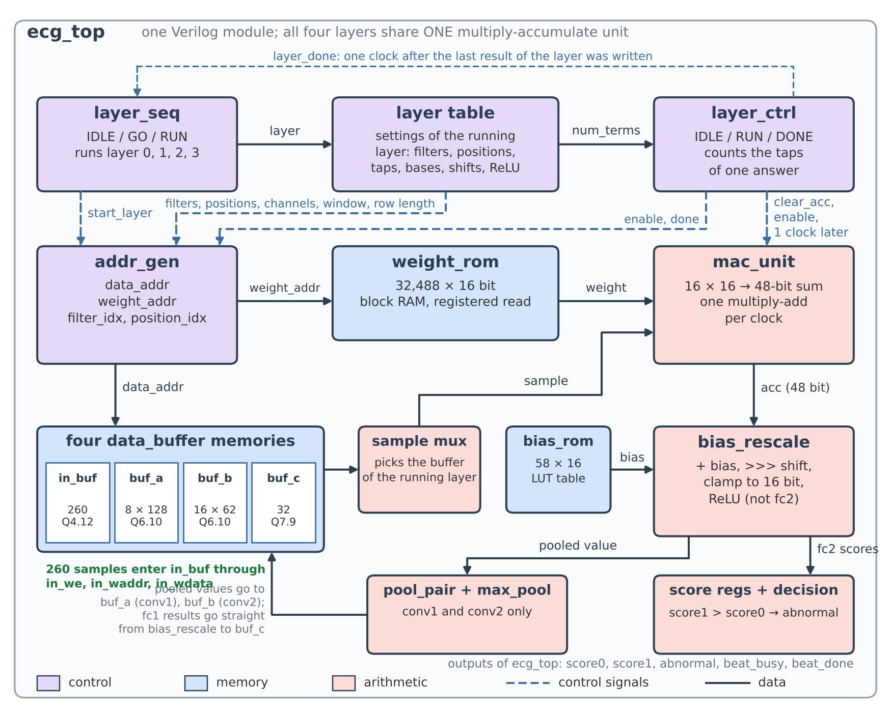

# A Low-Resource FPGA Accelerator for Real-Time ECG Arrhythmia Classification Using a Quantised 1D-CNN and a Shared MAC Unit

A small 1D convolutional neural network classifies one ECG heartbeat as **Normal** or **Abnormal**. The network is quantised to 16-bit fixed point and runs in Verilog on **one shared multiply-accumulate (MAC) unit** that executes all four layers one after the other. The design was synthesized and implemented in Vivado for the Zynq-7020 (`xc7z020clg400-1`).



## Results

| | |
|---|---|
| Network | conv1 (1→8, k5) → ReLU → pool → conv2 (8→16, k5) → ReLU → pool → fc1 (992→32) → ReLU → fc2 (32→2); 32,546 parameters |
| Data | MIT-BIH Arrhythmia Database, 260-sample beats, patient-independent split (38 training / 10 test records) |
| Accuracy (test, 24,526 beats) | float model 0.99; fixed-point model 98.51 % (Abnormal: precision 0.98, recall 0.93, F1 0.95 for the float model) |
| Speed | 129,552 clocks per beat = 2.591 ms at 50 MHz, about 386 beats per second (a 200 bpm heart needs 3.3) |
| Area (placed and routed) | 394 LUT, 213 FF, 17.5 block-RAM tiles, 2 DSP48, 128 slices |
| Timing at 50 MHz | met: setup slack +5.424 ns, hold slack +0.108 ns, about 69 MHz possible |
| Power (Vivado, vectorless) | 0.126 W total, 0.022 W dynamic (an estimate, not a measurement) |
| Exactness | Every value of every layer (4,066 per beat) matches a Python integer model bit for bit |

Honest notes on these numbers: the training epochs and the decision threshold were chosen while looking at the test set, so the accuracy is slightly optimistic. The test records contain only ventricular (V) and atrial (A) abnormal beats.

## Repository layout

| Folder | Contents |
|---|---|
| `hardware/` | The 12 synthesizable Verilog modules, all testbenches, `weights.hex`, `biases.hex`, the `answer_key/` test vectors and the Vivado Tcl scripts. Kept in one folder on purpose: the testbenches and scripts expect everything side by side. |
| `model/` | `ecg_training_colab.ipynb` (Colab notebook: MIT-BIH download, beat extraction, patient-independent split, training), the fixed-point reference model, ROM export, answer-key builder, and the quantised weights (`.pkl`). |
| `docs/` | `Golden_Model_and_Quantisation_Report.pdf` (training and quantisation), `ECG_Whole_RTL_Report.pdf` (every module, verification, Vivado results, full source listing) and `Synthesis_and_Implementation_Report.pdf` (Vivado synthesis and implementation, with a comparison to published FPGA designs). |

## Run the simulation

Needs [Icarus Verilog](https://bleyer.org/icarus/). From inside `hardware/`:

```
iverilog -o ecg_top_sim ecg_top.v layer_seq.v decision.v addr_gen.v layer_ctrl.v mac_unit.v bias_rescale.v max_pool.v pool_pair.v bias_rom.v weight_rom.v data_buffer.v ecg_top_tb.v
vvp ecg_top_sim
```

The last lines must read `total errors : 0` and `ALL TESTS PASSED` (about one minute). The test feeds 16 real test beats through the chip, 20 runs with resets and stray pulses, and compares every finished value against the answer key. The 16 beats were chosen to stress the hardware, not to measure accuracy.

## Vivado

`run_synth.tcl` and `run_impl.tcl` (Vivado 2026.1, batch mode) run synthesis and implementation out of context for `xc7z020clg400-1` with a 20 ns clock. Run them from inside `hardware/`; see the header of each script. `run_sim.tcl` is a Vivado-simulator script, but that simulator hung on my PC, so Icarus Verilog (above) is the verified route.

## Rebuild the data files

`model/export_rom_files.py` turns the quantised weights into `weights.hex` / `biases.hex`; `model/make_answer_key.py` builds `answer_key/`. `model/colab_define_model.py` holds the network definition used in the notebook. Only load `.pkl` files you trust.

## Status

Done: Python golden model, quantisation, Verilog RTL, simulation of every module and of the whole chip (including a gate-level simulation of the Yosys netlist on 3 beats), and Vivado synthesis and implementation with timing met.

Not done yet: no bitstream has been made and nothing has run on a board (a PYNQ wrapper is the next step). Timing and power come from an out-of-context run with an ideal clock, and the Vivado-routed netlist has not been simulated. `rst_n` is asynchronous, so a wrapper should synchronise its release. The header comment of `bias_rescale.v` still describes an earlier Q2.14 plan; the code is correct. Section 9 of the RTL report lists every open item.

## Data

The test beats in `hardware/answer_key/` are derived from the MIT-BIH Arrhythmia Database (PhysioNet, Open Data Commons Attribution License v1.0). The full database is not included.

- Moody GB, Mark RG. The impact of the MIT-BIH Arrhythmia Database. *IEEE Eng in Med and Biol* 20(3):45-50 (2001).
- Goldberger AL, et al. PhysioBank, PhysioToolkit, and PhysioNet. *Circulation* 101(23):e215-e220 (2000).

## License

MIT, see [LICENSE](LICENSE). The MIT-BIH data keeps its own license (see Data above).

## Author

S Harish Adithya, Rajalakshmi Engineering College.
